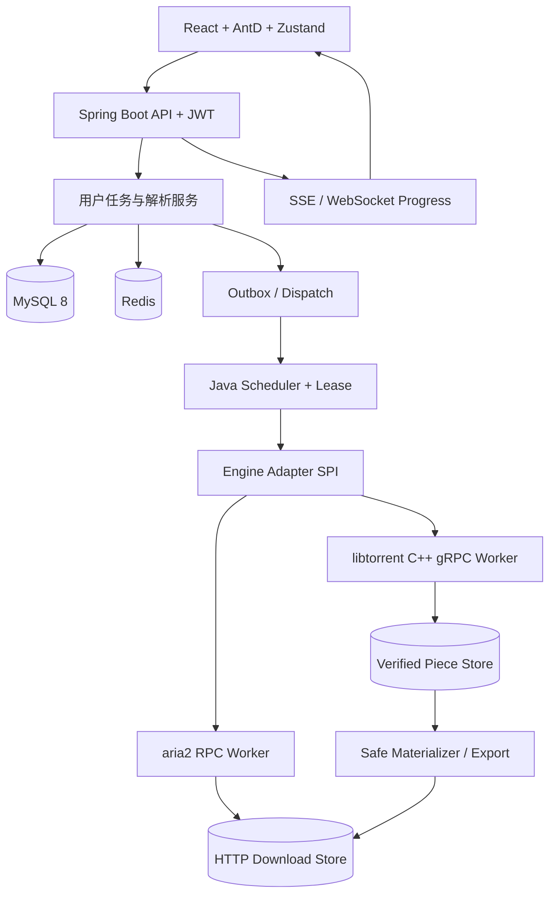

# Java 多用户 Magnet / BitTorrent 下载平台技术规格说明书

> 版本：1.0 | 日期：2026-10-21 | 状态：架构设计基线 | 参考：aria2、libtorrent、BEP 3、BEP 52

## 1. 项目定位和边界

建设 Java 21 + Spring Boot 3 的多用户下载管理平台。用户通过 Magnet URI / `.torrent`
创建解析记录、选择文件、配置受控保存位置、创建下载任务，并独立暂停、恢复、删除、查看进度与下载速度。BitTorrent 必须支持 V1、V2 与
Hybrid。HTTP(S) 可由 aria2 实现统一扩展。仅处理有权分发/下载的内容。

**术语澄清**：BitTorrent V1/V2 是两种协议版本；aria2 和 libtorrent 是两套 C++ 开源实现，不是两种协议。Magnet
是资源标识/发现入口，不是另一套传输协议。

### 1.1 目标与非目标

- P0：用户、解析历史、BT V1/V2/Hybrid、`.torrent`、逐文件选择、开始/暂停/继续/删除、断点续传、实时状态、文件完整性校验、服务重启恢复、权限隔离。
- P1：同一资源多用户复用已校验数据、按文件分配任务进度、速度/连接数配额、DHT/PEX/LSD、Tracker 管理、故障恢复、下载完成文件的授权提取。
- P2：多 Worker 安全接管、跨主机共享存储、集群公平调度、可观测性仪表盘、HTTP(S)/Metalink 引擎、可控做种。
- 非目标：绕过内容访问授权、自动获取私人 Tracker 凭据、跨用户公开文件列表、任意用户直接访问服务器绝对路径。性能不承诺固定下载速度，受源可用性及链路条件影响。

## 2. 参考实现的职责与限制

| 参考项目                     | 强项                                                 | 建议使用方式                         | 注意事项                                                       |
|--------------------------|----------------------------------------------------|--------------------------------|------------------------------------------------------------|
| aria2                    | JSON-RPC、HTTP(S)/FTP/SFTP、Metalink、分段下载、任务管理       | HTTP(S)/Metalink 引擎以及 RPC 设计参考 | 不作为 BT V2 的合规实现依赖；独立进程需密钥和环回绑定                             |
| libtorrent-rasterbar 2.x | BT V1/V2/Hybrid、DHT、PEX、LSD、Peer、Piece、Resume Data | 首选 BT 引擎，作为单独 C++ Worker 服务运行  | Java 没有官方直接 Java API；通过自研 gRPC/Protobuf IPC，或评估 JNI/JNA 方案 |
| 自研 Java Engine SPI       | 用户业务、调度、跨引擎抽象                                      | Java 持久化任务与调用适配器               | 不重复实现成熟底层 BT 网络协议                                          |

**默认执行方案**：Java 控制面 + libtorrent C++ gRPC Sidecar（BT）+ aria2 JSON-RPC Sidecar（HTTP）+ MySQL + Redis + Linux
本地磁盘。这样既可让核心业务保持 Java，也保留未来替换底层引擎的能力。不要让一个 BitTorrent 资源同时由 aria2 和 libtorrent
写入同一目录。业务 `taskId` 不等于 aria2 `gid` 或 libtorrent `torrent_handle`。

## 3. 协议技术规格

### 3.1 V1 / V2 / Hybrid

| 项目        | V1                   | V2                                       | Hybrid             |
|-----------|----------------------|------------------------------------------|--------------------|
| 参考规范      | BEP 3                | BEP 52                                   | BEP 52             |
| 内容标识      | SHA-1 infohash 20 字节 | SHA-256 infohash 32 字节                   | 两个 infohash 均需保存   |
| Magnet xt | `urn:btih:`          | `urn:btmh:` multihash                    | 可以同时包含 btih 与 btmh |
| 验证        | Piece SHA-1          | SHA-256 Merkle 树及 hash proofs            | 分别保证 V1/V2 验证语义    |
| 文件描述      | `files`/`length`     | `file tree`、`pieces root`、`piece layers` | 两套元数据兼容            |
| 引擎选择      | libtorrent           | libtorrent 2.x                           | libtorrent 2.x     |

- 解析 Magnet 时独立识别并验证 `xt`、`tr`、`dn`、`xl`；`dn` 和 `xl` 只是提示，不能作为可信元数据或磁盘分配依据。
- `btih` 支持 40 位十六进制及合规的 Base32 形式；`btmh` 使用多哈希编码并按规范校验。
- Metadata 必须从可信格式的 `.torrent` 或经协议获取的元数据解析，且明确格式、文件列表、长度、路径层级、哈希集合；限制 bencode
  嵌套深度、字符串长度及元数据体积。
- V2 Merkle 叶节点以 16 KiB 数据块生成 SHA-256；验证 `pieces root` / proof，不能直接将整个 Piece 做一次 SHA-256 来冒充 V2
  验证。
- Hybrid 同时保存 V1/V2 哈希，资源规范化时允许按元数据证明同一资源，不能仅凭显示名称/文件总长度/未校验 Magnet 文本合并。
- V2 Piece 具备文件对齐语义，V1 的 Piece 可能跨越文件边界；因此只选择某个文件时可能额外下载少量相邻数据以验证边界，不计入用户请求的文件大小。

### 3.2 Peer 和 Tracker 子模块（由 libtorrent 提供）

- Tracker HTTP/HTTPS 和 UDP Announce（协议允许情况下）；存储来源、健康度、last_success、错误类别；私有 Torrent 遵循 private 约束。
- DHT V1/V2 相关能力需依赖锁定的 libtorrent 版本进行互操作验证；PEX、LSD 可以配置启停；限制 Peer 数、握手超时及连接资源。
- 网络可支持 TCP 和 uTP（由引擎能力决定）；IPv4/IPv6 双栈按实际环境启用。
- Peer 调度交由 libtorrent；若将来研发原生调度器，需单独建立 Piece Picker、请求流水线、慢 Peer
  降权、End-game、超时重试与数据完整性验证的性能基线。
- 可选代理：SOCKS5 / HTTP(S) 代理参数与 DNS 策略统一治理，明确 DHT/UDP 和代理的兼容限制，不把代理视为必然提速。

## 4. 用户行为与业务规则

### 4.1 用户与租户

- RBAC：`ADMIN`、`USER`；未来增加 `TENANT_ADMIN`；所有读写接口从访问令牌获取实际 `userId`，不接受客户端任意指定用户 ID。
- 普通用户仅能列出、控制、下载、删除本人任务；管理员运维查阅需审计。
- 同一用户同一资源可以创建多个任务，但需显式标记不同文件选择或目标目录；默认以客户端幂等 Key 防止误重复提交。
- 每个用户的 `pause/resume/delete` 只改变用户意图；共享底层会话按仍然需要的用户任务聚合。
- 文件路径为服务器管理员授权的 `storageRoot` 下的逻辑目录；不能由 Web 客户端提供任意服务器绝对路径。

### 4.2 资源解析（先解析后下载）

1. 用户提交 Magnet 或 `.torrent`；服务先做格式、大小、安全校验。
2. 创建 `parse_job`，状态 `PENDING → RESOLVING → READY | FAILED | TIMEOUT`；必须允许查看历史并重试。
3. 获取元数据后持久化 `torrent_resource` 和 `torrent_file`；将规范化内容哈希保存为资源标识。
4. UI 显示目录树、文件大小、文件序号、路径、合计大小、V1/V2/Hybrid 类型、Tracker 数、解析来源。
5. 用户勾选文件、指定受控子目录、确认创建任务；创建动作不能立即覆盖任何同名文件。
6. 仅解析但没有下载用户需求时，Metadata-only 引擎会话应按 TTL 释放网络资源，历史仍保留。

### 4.3 下载任务

- 每个用户任务独立：任务状态、选中文件集、完成/有效数据字节数、任务优先级、用户限速、开始/完成时间、错误、文件提取路径。
- 全局共享下载会话独立：`resourceId`、选中 Piece 的需求并集、Tracker/Peer、底层引擎句柄、已验证 Piece 映射、恢复快照、引用计数。
- 进度采用 **用户选择文件的实际已验证字节数 / 所选文件的总字节数**；显示速度可以按用户任务归因估算并标注为逻辑任务速度，不可将同一真实吞吐重复计入多个用户的全局测速结果。
- 恢复任务时重新计算其数据可用性；如果物理数据已删除或损坏，任务需转为 `REPAIRING` 或 `QUEUED`，不允许凭数据库进度直接显示完成。
- 删除分两种：`REMOVE_TASK_ONLY`（只删用户引用与任务状态）、`REMOVE_TASK_AND_OWN_EXPORT`（删自己的导出副本）；清理共享底层块必须在所有引用释放后由
  GC 异步执行。

## 5. 任务状态机

### 5.1 用户任务

`CREATED → QUEUED → STARTING → DOWNLOADING → VERIFYING → COMPLETED`

特殊流程：`QUEUED|DOWNLOADING → PAUSING → PAUSED → QUEUED`；`DOWNLOADING|STARTING → RETRY_WAIT → QUEUED`；
`ANY_NON_TERMINAL → FAILED`；`ANY → DELETING → DELETED`。状态 `COMPLETED` 遇到文件完整性失败时重新进入
`REPAIRING → QUEUED`，必须记录原因和版本。

### 5.2 真实资源会话

`DISCOVERING → METADATA_READY → ACTIVE → IDLE → STOPPED`；异常情况下 `ACTIVE → RECOVERING → ACTIVE|FAILED`。会话 `ACTIVE`
依赖至少一个未暂停且未终结的用户任务，或者显式获准的做种策略。

### 5.3 状态变更约束

所有命令须幂等，使用 `expectedVersion`/`version` CAS；业务意图先持久化后驱动引擎；Worker 反馈只能在有效执行 Epoch
内写入。用户的暂停是 **不再分配该任务需求**，当其他用户仍下载同一文件时，底层共享会话无需停止；该用户任务逻辑下载字节数冻结（缓存数据归属需在恢复时对账）。

## 6. 总体架构



### 6.1 工程模块

```text
magnet-platform/
  server/
    download-api/              # HTTP、DTO、鉴权、WebSocket/SSE
    download-domain/           # 状态机、Task、Resource、策略
    download-application/      # 流程编排、事务、出站事件
    download-infrastructure/   # MyBatis XML、MySQL、Redis、文件
    download-engine-spi/       # 引擎抽象和 DTO
    download-engine-libtorrent/# gRPC Client
    download-engine-aria2/     # JSON-RPC Client
    download-scheduler/        # 调度、租约、回收与对账
  native/
    libtorrent-worker/         # C++ Session、torrent_handle、alert 转发
    proto/download_engine.proto
  web/                         # React + TypeScript + Ant Design
  infra/                       # compose、systemd、nginx、migrations
  docs/                        # API、协议、运维、验收
```

## 7. Java 引擎适配器规范

```java
public interface DownloadEngine {
    EngineKind kind();
    EngineCapabilities capabilities();
    EngineSession createOrAttach(ResourceDescriptor resource, EngineOptions options);
    void setDemand(String engineSessionId, Set<Integer> requestedFileIndices);
    void pauseSession(String engineSessionId);
    void resumeSession(String engineSessionId);
    EngineSnapshot snapshot(String engineSessionId);
    ResumeSnapshot saveResume(String engineSessionId);
    void removeSession(String engineSessionId, boolean removeUnreferencedData);
}

public record EngineCapabilities(boolean bittorrentV1,
                                 boolean bittorrentV2,
                                 boolean hybrid,
                                 boolean http,
                                 boolean selectiveFiles,
                                 boolean resumable) {}
```

`setDemand` 接收同一资源所有活跃用户选择的文件下标**并集**，而不是某一用户的选项。底层 Piece
优先级、文件优先级和任务优先级的转换属于适配器职责。aria2 不与 libtorrent 共享 BT Session 语义。每次 Worker 命令携带
`commandId`、`resourceId`、`ownerEpoch`、`deadline` 以实现去重和拒绝过期执行。

### 7.1 libtorrent Worker API（gRPC）

`ResolveMetadata`, `AddTorrent`, `UpdateFilePriorities`, `Pause`, `Resume`, `GetSnapshot`, `SaveResumeData`,
`RemoveTorrent`, `StreamAlerts`, `Health`。C++ Worker 不持有用户级鉴权决策；所有用户级授权由 Java 服务执行，并限制 Worker
到内网 mTLS/Unix socket。

重要：libtorrent `torrent_handle` 是进程本地对象，不能作为数据库永久主键；保存 `resource_id` 和可重建的 session
snapshot。Resume Data 是恢复提示而不是授权真相或已验证数据的永久凭证。

## 8. MySQL 核心数据模型

| 表                    | 主要字段                                                                                                         | 唯一键与职责                                              |
|----------------------|--------------------------------------------------------------------------------------------------------------|-----------------------------------------------------|
| `app_user`           | id, username, password_hash, status                                                                          | 用户身份                                                |
| `torrent_resource`   | id, canonical_key, btih, btmh, version_type, metadata_uri, total_bytes, created_at                           | btih / btmh 独立唯一，允许空值；完整元数据核对                       |
| `torrent_file`       | id, resource_id, file_index, relative_path, size_bytes, v2_pieces_root                                       | `(resource_id,file_index)`                          |
| `parse_job`          | id, user_id, resource_id, input_hash, status, error_code, created_at                                         | 保留每人的解析历史                                           |
| `download_task`      | id, user_id, resource_id, status, selected_bytes, verified_bytes, priority, speed_limit, version, created_at | 用户逻辑任务                                              |
| `download_task_file` | id, task_id, file_index, selected, verified_bytes, export_state                                              | `(task_id,file_index)`                              |
| `engine_session`     | id, resource_id, worker_id, engine_type, state, owner_epoch, lease_until, resume_version                     | `(resource_id, engine_type, storage_domain)`，依照存储策略 |
| `verified_piece`     | id, resource_id, piece_index, store_key, length, verification_scheme, verified_at                            | `(resource_id,piece_index,verification_scheme)`     |
| `piece_ref`          | id, task_id, piece_id, ref_state                                                                             | 任务对已验证数据的需求/引用；可通过聚合模型代替物化                          |
| `download_command`   | id, task_id, command_id, command_type, expected_version, status                                              | 命令幂等                                                |
| `worker_lease`       | id, resource_id, worker_id, epoch, lease_until, updated_at                                                   | 同资源独占活动所有权                                          |
| `task_event`         | id, task_id, event_type, payload_json, created_at                                                            | 事件审计                                                |
| `outbox_event`       | id, aggregate_id, event_type, payload_json, dispatched_at                                                    | 事务 Outbox                                           |
| `file_export`        | id, task_id, user_id, relative_target, state, bytes, created_at                                              | 按用户导出文件管理                                           |

数据类型建议：UUID 使用 `BINARY(16)`；大小、字节、版本 `BIGINT`；哈希采用 `BINARY(20)` / `BINARY(32)`；状态 `VARCHAR(32)`；时间
`DATETIME(6)` UTC。`torrent_resource` 的双哈希去重需做好 V1-only / V2-only 后续发现同一个 Hybrid 的原子合并，必要时使用别名映射表
`resource_hash_alias(hash_type, hash_bytes, resource_id)`，避免分别创建两个物理资源。

### 8.1 并发安全

- 不允许用 `selected_bytes` 或 UI 进度判断磁盘可信数据，完成态由验证器证据决定。
- SQL 更新采用 `WHERE id=? AND version=?` 并 `version=version+1`；租约操作必须使用 MySQL 同一个时间源，释放和续约都带
  `owner_epoch`。
- 分布式锁只能辅助；写文件、持久化 Checkpoint、GC 需通过 Epoch/Fencing + 单写者保证一致。
- 删除任务后保留审计墓碑，防止迟到的异步状态回写把任务“复活”。

## 9. REST API 规范（/api/v1）

| 方法       | 路径                                       | 用途                                       |
|----------|------------------------------------------|------------------------------------------|
| `POST`   | `/parses`                                | 提交 Magnet 或 torrent（文件推荐 multipart 独立端点） |
| `GET`    | `/parses`                                | 分页查询本人解析历史                               |
| `GET`    | `/parses/{parseId}`                      | 查询解析状态及结果                                |
| `POST`   | `/parses/{parseId}/retry`                | 重新解析                                     |
| `GET`    | `/resources/{resourceId}/files`          | 获取本人已解析授权资源的文件树                          |
| `POST`   | `/tasks`                                 | 基于解析结果、文件下标和保存子目录创建任务                    |
| `GET`    | `/tasks`                                 | 分页、条件过滤、排序                               |
| `GET`    | `/tasks/{id}`                            | 本人任务详情                                   |
| `POST`   | `/tasks/{id}/pause`                      | 逻辑暂停                                     |
| `POST`   | `/tasks/{id}/resume`                     | 继续任务                                     |
| `POST`   | `/tasks/{id}/retry`                      | 错误重试                                     |
| `PATCH`  | `/tasks/{id}`                            | 修改用户级限速/优先级                              |
| `DELETE` | `/tasks/{id}?removeOwnExport=false`      | 删除任务与可选用户副本                              |
| `GET`    | `/tasks/{id}/files`                      | 文件维度进度与状态                                |
| `GET`    | `/tasks/{id}/events`                     | SSE 实时事件                                 |
| `GET`    | `/tasks/{id}/exports`                    | 本人可访问的完成文件                               |
| `GET`    | `/tasks/{id}/exports/{exportId}/content` | 授权下载完成文件（流式）                             |

### 9.1 创建任务示例

```http
POST /api/v1/tasks
Authorization: Bearer <JWT>
Idempotency-Key: 74bd... 
Content-Type: application/json

{
  "parseId": "74e2fa1a-...",
  "fileIndices": [0, 2, 3],
  "targetSubdirectory": "iso/2026",
  "startImmediately": true,
  "priority": 5
}
```

```json
{
  "taskId": "39cc3f11-...",
  "status": "QUEUED",
  "selectedBytes": 6518974464,
  "verifiedBytes": 0,
  "progressPercent": 0.0,
  "version": 1
}
```

返回码：201 创建成功；202 接受异步控制命令；400 参数错误；401 未登录；403 无权访问；404 不存在或不可访问；409 版本/状态冲突；422
Torrent 不合规；429 配额超过；503 Worker 不可用。不可访问资源统一使用 404 以减少 ID 枚举。

### 9.2 SSE 事件模型

```json
{
  "eventId": "evt-001",
  "taskId": "39cc3f11-...",
  "sequence": 120,
  "status": "DOWNLOADING",
  "totalSelectedBytes": 1000000000,
  "verifiedSelectedBytes": 476000000,
  "progressPercent": 47.6,
  "estimatedDownloadBytesPerSec": 2100000,
  "peerCount": 35,
  "timestamp": "2026-10-21T12:30:00Z"
}
```

前端收到乱序事件应依 `sequence` 去重；断开后以 `Last-Event-ID` 补拉事件或重新读取 Snapshot。进度推送默认 1-2 秒聚合一次，而不是每个
Block 都推送。

## 10. 共享 Piece Store 与隔离

### 10.1 数据分层

1. **Resource**：不可变 Torrent 身份和已验证元数据；全局只读，可有哈希别名。
2. **Engine Session**：某个 Worker 中用于获取数据的动态会话；按资源+安全存储域唯一。
3. **Verified Piece Store**：经过对应 V1/V2 验证后存储的字节与证据，按资源、Piece、校验方案索引。首次落地优先用 libtorrent
   原生文件布局，避免直接从 JNI 拦截每个 Block。
4. **User Task**：每人的文件选择、优先级、暂停意图、状态和统计。
5. **User Export**：只有在明确授权时将完整文件安全复制/硬链接（需要安全域约束）/CoW 克隆至用户目录。

**关键实现取舍**：libtorrent 默认管理其下载目录和磁盘存储。若希望跨 Torrent 任意 Piece 级去重，需要开发 custom
`disk_interface` 或在完成校验后导入 CAS；这不是 libtorrent 自动提供的 SaaS 多用户去重能力。第一阶段仅同一资源共用底层会话和数据；第二阶段再实现
CAS / 引用 GC。

### 10.2 Reference GC

- 垃圾回收需同时检查有效任务引用、做种策略、活动租约、未完成导出、恢复快照、保留期。
- 先标记 `GC_CANDIDATE`、宽限期、重复核查，然后原子改为 `GC_DELETING`，禁止新引用，最后删除数据。
- 容错要求：GC 进程崩溃或跨 Worker 接管不会误删别人使用的 Piece。
- 私有 Torrent 不与其他安全域共享元数据或物理文件，强制隔离策略优先于去重率。

## 11. 调度、公平性、限流

- 调度单位是用户任务需求，但实际资源供给属于 Session；需同时做用户级、租户级、Worker 级和全局级资源预算。
- 首版策略：每用户最大活跃任务数、队列优先级、单任务最大连接数和速度配额；跨用户共享会话公平计量时，不将同一下载带宽重复收费/计量。
- 为避免低速 Peer 空转，先测量活跃 Peer、可用 Piece、请求队列、RTT P95、Socket 阻塞、磁盘延迟、重复请求、下载与上传字节，再调参数。
- 对于 libtorrent，可使用其已有 Piece picker、连接与请求调度；Java 调度器不直接控制每个 Peer 的 Block 请求。
- 快速/慢速网络分流、单任务速度限制与全局限速互不覆盖；配置项在 Worker 层映射并记录生效结果。
- 总进度刷新用低开销快照，历史速度在 Timeseries / Redis 存储 TTL；MySQL 保存关键事件而不是每秒写入全部指标。

## 12. 重启恢复、多 Worker 与 Fencing

### 12.1 单 Worker 第一阶段

持久化创建意图 -> libtorrent 写入下载文件并周期保存 resume data -> 记录状态 -> 重启时扫描 MySQL 会话 -> 读取已有文件和
resume data -> 重新校验必要数据 -> 恢复未暂停用户需求。所有持久化过程采用先落盘临时文件、fsync、原子
rename；数据库版本和文件快照版本必须关联。

### 12.2 多 Worker 第二阶段

- 为同一个物理资源目录只允许一个活动 Worker 写入；使用 MySQL 获取资源级租约和单调递增的 `owner_epoch`。
- 旧 Owner 一旦续约失败必须停止写；新 Owner 先完成旧 Owner 的终止确认/共享存储 fencing，再重新核验磁盘及 resume data。
- 只有数据库 Epoch 不足以隔离仍在运行的旧 native 进程写磁盘；需要进程隔离、独占目录/文件锁、存储级 fencing 或停止旧容器并确认退出。
- 续租与 Epoch 比较使用 MySQL 时间源。跨机器必须确认共享存储语义，不允许把两台机器上不同的本地 `/downloads` 当成相同文件。
- 断网/数据库故障期间默认 fail-closed，避免双活写入。需要测试自然过期、并发接管、网络分区、文件锁中断、数据库故障切换、崩溃恢复。

## 13. 存储与下载安全

- 解析/输出路径使用 canonical relative path，拒绝 `..`、绝对路径、Windows
  驱动器名、NUL、控制字符、符号链接逃逸、同名大小写冲突与超长路径；禁止下载任务控制端映射服务器系统目录。
- 对 `.torrent` 上传设置字节上限，bencode 解析限制深度/节点数/整数范围；对 `piece length=0` 等畸形元数据必须拒绝而不是崩溃。
- 不信任 Torrent 包含的文件路径和 Tracker URL；禁止通过 Tracker 或用户提供的 URL 访问云元数据服务、环回地址、私有管理网段等未授权目标，防
  SSRF。必要时强制出口代理策略、DNS 重绑定检查。
- 前端只显示用户级文件数据，种子私有 Tracker passkey 等敏感参数不得出现在公开日志、SSE 或共享缓存键中。
- 文件下载出口由 Java 做身份校验和流式读取；可用 Nginx `X-Accel-Redirect` 承接实际文件响应，但内部真实路径不可由用户控制。
- 限制单用户解析次数、单任务文件数、磁盘配额、Tracker 请求数、磁盘预分配字节数。备份恢复必须排除或保护敏感文件。
- 评估 aria2 GPL-2.0 与 libtorrent 的对应授权条款，确定静态/动态链接、分发和修改源码的合规方案；具体以锁定提交中的 LICENSE
  文件为准。

## 14. 前端需求

页面：登录、首页统计、添加 Magnet、解析历史、解析详情及树状文件选择、我的下载、任务详情、我的已完成文件、个人配额、管理员
Worker/存储运维、告警与任务审计。

任务表：名称、协议类型、资源大小、已选大小、校验进度、真实与归因速度、Peer 数、状态、错误、开始时间、操作。任务详情提供
Tracker、文件、速度趋势、事件时间线、恢复状态；显示下载速度时标注逻辑速度/会话真实速度。

前端使用 React + TypeScript + Ant Design + Zustand；SSE 主动订阅可见任务，页面不可见时降频；所有按钮根据状态机禁用非法命令。
`delete` 必须二次确认，并明确“删除我的任务”和“删除我的导出文件”区别。

## 15. 性能和可靠性验收（初始建议目标，非实测）

| 指标         | 建议目标                               | 验收方式            |
|------------|------------------------------------|-----------------|
| API 列表 P95 | < 300 ms（不含网络外部耗时）                 | 100 并发、1 万条用户任务 |
| 用户暂停响应     | 命令 1s 内入队；最终状态按 Worker 应答          | 故障注入与时延分布       |
| 进度事件       | 正常情况下间隔 ≤ 2s                       | SSE 端到端追踪       |
| 同一资源复用     | 10 用户下载同一资源仅 1 活动 BT Session（同存储域） | 进程/引擎会话观测       |
| 隔离         | A 无法查询、操控、读取 B 私有任务/导出             | REST 越权自动化测试    |
| 完整性        | V1、V2、Hybrid 全部正确验证；注入坏块必拒收        | 官方/公开合法测试集      |
| 恢复         | 单 Worker 重启后任务与已校验数据可恢复            | kill -9 / 冷启动   |
| 删除安全       | 一个用户删除后不影响其他人的任务和文件                | 多用户交错测试         |
| Worker 高可用 | 旧 Worker 写入已 fenced 才准新 Worker 接管  | 双机网络分区测试        |

## 16. 测试矩阵

- 协议：V1、V2、Hybrid、V1-only Magnet、V2-only Magnet、双哈希 Magnet、`.torrent`；错误哈希、损坏 Piece、Mer​​kle 不一致、Metadata
  超时、Tracker 不可达。
- 多用户：两个用户同 Magnet、不同文件选择、同文件选择；A 暂停/B 继续；A 删除/B 继续；A 恢复时已有 Piece 自动对账；10/100
  个相同资源任务的统计正确性。
- 恢复：应用重启、Worker kill -9、磁盘已满、路径权限变化、Resume Data 损坏、SQL 超时、Redis 不可用、数据库重连。
- 并发：重复创建、重复暂停/恢复、删除与恢复竞态、Tracker 事件迟到、资源合并竞态、双 Worker 同时抢租约。
- 安全：目录穿越、符号链接逃逸、SSR​​F、恶意 bencode、任意文件读取、跨用户文件泄漏、未授权导出。
- 回归：每次修改调度器后执行相同合法公开分发测试文件、多环境对比速度分布与完整性，避免仅以峰值速度优化。

## 17. 里程碑与交付

| 阶段          | 优先级 | 主要交付                            | 退出标准               |
|-------------|-----|---------------------------------|--------------------|
| P0 基础设施     | 必须  | Java 多模块、JWT、MySQL、API、前端骨架     | 用户资源隔离通过           |
| P1 Metadata | 必须  | V1/V2/Hybrid 解析、历史、文件树          | 合规种子解析与异常处理通过      |
| P2 下载任务     | 必须  | libtorrent Worker、任务状态、文件优先级、恢复 | 单用户真实下载端到端通过       |
| P3 多用户复用    | 必须  | 同资源单 Session、聚合需求、独立控制          | A/B 暂停/删除不互扰       |
| P4 数据安全     | 必须  | Resume、哈希验证、完成导出、路径安全、GC        | 损坏/重启/越权测试通过       |
| P5 高可用      | 后续  | Worker Lease、Epoch、Fencing、接管   | 双 Worker 分区/故障测试通过 |
| P6 多协议      | 后续  | aria2 HTTP(S)/Metalink SPI 接入   | 统一任务 API 对多个引擎成立   |
| P7 优化       | 后续  | 监控/吞吐/配额/限流/用户体验                | 性能和公平性指标满足目标       |

## 18. 关键架构决策（ADR）

- ADR-001：Java 只负责用户层控制面，libtorrent 2.x 实现 BT 数据面；不从零重写完整 BT 协议。
- ADR-002：支持 BitTorrent V1、V2、Hybrid；aria2 的 BT 能力不用于 V2 验收。
- ADR-003：任务状态和底层会话分离；用户暂停/删除不会直接停止共享 Session。
- ADR-004：同资源共享先于跨资源 CAS；首版优先保障真实下载稳定性和磁盘校验一致性。
- ADR-005：后端 API 不暴露 native Engine Session ID 或 C++ 指针。
- ADR-006：集群扩展必须有真实磁盘 fencing，不以 Redis 锁或纯 DB 租约代替物理写隔离。
- ADR-007：仅为经授权内容下载提供功能；默认最小暴露 Tracker 和下载路径数据。

## 19. 规范与资料

1. aria2: https://github.com/aria2/aria2
2. aria2 Manual: https://aria2.github.io/manual/en/html/
3. libtorrent: https://github.com/arvidn/libtorrent
4. libtorrent Features: https://libtorrent.org/features-ref.html
5. libtorrent 2.0 Migration: https://libtorrent.org/upgrade_to_2.0-ref.html
6. BEP 3: https://www.bittorrent.org/beps/bep_0003.html
7. BEP 52: https://www.bittorrent.org/beps/bep_0052.html
8. BEP 9 Metadata: https://www.bittorrent.org/beps/bep_0009.html
9. BEP 5 DHT: https://www.bittorrent.org/beps/bep_0005.html
10. BEP 11 PEX: https://www.bittorrent.org/beps/bep_0011.html
11. aria2 V2 issue: https://github.com/aria2/aria2/issues/1773

**实现说明**：本文为可开发规格与建议的验收基线，而非已实现能力清单。开始编码前应锁定 libtorrent/aria2 的实际发行版本、C++
ABI、Java/C++ IPC schema、MySQL migration、存储布局以及版权合规边界。
